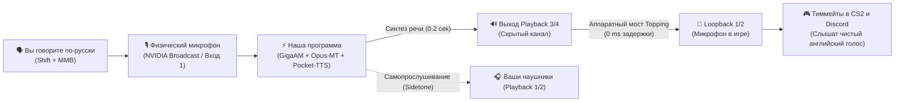

# 🎧 Руководство: Как работает Topping E2x2 OTG и Loopback (Шпаргалка на века)

> **Для чего этот документ:** Чтобы вы (или любой человек) даже через год, после переустановки Windows или покупки нового ПК, могли за 30 секунд настроить звук и сразу играть с переводом голоса в CS2 и Discord.

---

## 1. Что такое Loopback простыми словами?

В обычной звуковой карте есть только вход (микрофон) и выход (наушники).  
В профессиональной карте **Topping E2x2 OTG** производитель сделал аппаратную функцию **Loopback (аппаратная петля)**.

Представьте, что внутри карты есть **«невидимый провод»**:
1. Наша программа берет ваш русский голос с микрофона и за 0.2 секунды переводит его нейросетью в английский с вашим тембром.
2. Программа отправляет этот звук в невидимый для ваших ушей канал **`Playback 3/4`**.
3. Звуковая карта Topping прямо внутри своего процессора мгновенно соединяет канал `Playback 3/4` с виртуальным микрофоном **`Loopback 1/2`**.
4. Игра (CS2) и Discord слушают этот **`Loopback 1/2`** и думают, что это ваш реальный микрофон!

**Почему это гениально:**
- **0.0 миллисекунд задержки** (звук перенаправляется аппаратно, а не через драйверы Windows).
- **0% нагрузки на процессор** (никаких сторонних программ вроде VB-Audio Cable или Voicemeeter, которые сбиваются после обновлений Windows).
- **Идеальная чистота** (звук не хрипит и не заикается).

---

## 2. Шпаргалка: 3 коротких имени (Настройка за 10 секунд)

> 💡 **Авто-переименование в 1 клик:** Запустите файл `RENAME_TOPPING.bat` (или нажмите фиолетовую кнопку в Студии Голоса) — Windows сама переименует сложные системные названия в эти простые имена:

| Где настраивать | Простое имя устройства | Старое системное имя | Зачем это нужно |
| :--- | :--- | :--- | :--- |
| **1. Звук Windows (Динамики)** | **`Наушники`** | `Playback 1/2` | Ваши наушники (игра, музыка, перевод). |
| **2. Наш Лаунчер (Этап 3)** | **`Голос ИИ`** | `Playback 3/4` | Канал озвучки ИИ в звуковую карту. |
| **3. Discord / CS2 / Telegram** | **`ИИ Микрофон`** | `Loopback 1/2` | **Микрофон в игре (что слышат тиммейты)!** |

---

## 3. Схема движения звука (Signal Flow)

---

## 4. Как управлять во время игры (Золотые клавиши)

- **`Shift + Колесико мыши (MMB)`**: Нажали и держите ➔ говорите фразу на русском ➔ отпустили ➔ через 200 миллисекунд нейросеть озвучила фразу вашим клонированным голосом на английском прямо в игру.
- **`F9`**: Главный тумблер (Мастер-пауза). Если нужно временно отключить все субтитры и перевод — нажали `F9`. Нажали снова — всё возобновило работу.

---

## 5. Если через год ничего не слышно (Чеклист проверки):

1. **Включен ли Loopback в Topping Control Center?**
   - Откройте панель Topping на панели задач.
   - Убедитесь, что регулятор `Playback 3/4` не заглушен (Mute выключен).
2. **Что выбрано в Discord?**
   - Зайдите в *Настройки Discord ➔ Голос и видео ➔ Устройство ввода*.
   - Там **обязательно** должно стоять: `Loopback 1/2 (6- E2x2 OTG)`.
3. **Запущен ли Этап 3?**
   - Нажмите `START.bat` и убедитесь, что карточка **Этап 3** горит зеленым (`🟢 Работает`).

