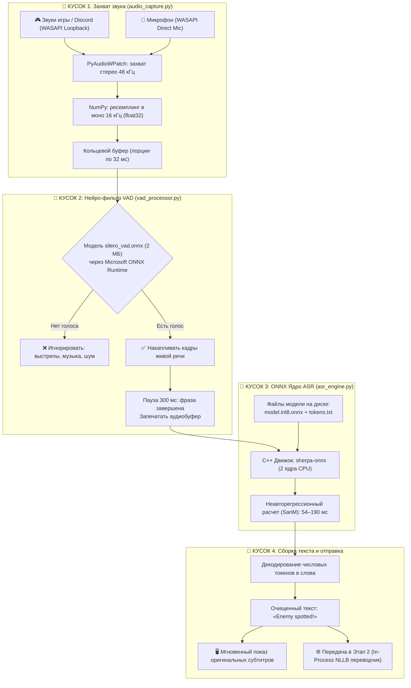

# Архитектура Этапа 1: Захват звука, VAD-фильтрация и ASR-распознавание (ONNX)

Документ описывает физическое устройство, движение данных и распределение ролей в **Этапе 1** экосистемы реального времени.

---

## 1. Общая визуальная схема конвейера (Pipeline Map)

```text
┌────────────────────────────────────────────────────────────────────────┐
│  КУСОК 1: ЗАХВАТ ЗВУКА ИЗ WINDOWS (Audio Capture)                      │
│  [Динамики / Наушники / Микрофон]                                      │
│         │ (Стереозвук 48 000 Гц)                                       │
│         ▼                                                              │
│  [Модуль audio_capture.py + PyAudioWPatch]                             │
│         │ Превращение в: Моно, 16 000 Гц, массив чисел float32         │
└─────────┼──────────────────────────────────────────────────────────────┘
          │ (Сырой аудиопоток нарезается на чанки по 32 миллисекунды)
          ▼
┌────────────────────────────────────────────────────────────────────────┐
│  КУСОК 2: НЕЙРО-ШЛЮЗ ТИШИНЫ И ВЫСТРЕЛА (Silero VAD на ONNX)            │
│  [Файл модели: silero_vad.onnx (2 МБ)]                                 │
│  [Движок: Microsoft ONNX Runtime]                                      │
│         │                                                              │
│         ├─► Тишина / Гул игры / Стрельба без голоса ──► [В МУСОР]      │
│         │                                                              │
│         └─► Человеческий голос ──► [Накопление непрерывной фразы]      │
│                                    (Пауза 300 мс = фраза запечатана)   │
└─────────┼──────────────────────────────────────────────────────────────┘
          │ (Запечатанный кусок чистого голоса: например, 1.5 секунды)
          ▼
┌────────────────────────────────────────────────────────────────────────┐
│  КУСОК 3: САМ ONNX И ЕГО C++ ДВИЖОК (Нейросетевое ядро ASR)            │
│                                                                        │
│   ┌────────────────────────────────────────────────────────────────┐   │
│   │ 1. ФАЙЛЫ ВЕСОВ ONNX (Лежат на диске):                          │   │
│   │    • model.int8.onnx (~230 МБ) — сама сжатая нейросеть         │   │
│   │    • tokens.txt — словарь соответствия чисел и букв/слов       │   │
│   └────────────────────────────────┬───────────────────────────────┘   │
│                                    ▼                                   │
│   ┌────────────────────────────────────────────────────────────────┐   │
│   │ 2. ДВИЖОК ВЫЧИСЛЕНИЙ (C++ Runtime Engine):                     │   │
│   │    • sherpa-onnx / onnxruntime.dll (Скомпилированный C++)      │   │
│   │    • Загружает файл .onnx в оперативную память                 │   │
│   │    • Выполняет матричные умножения на 2 ядрах Ryzen 7800X3D    │   │
│   │    • Время расчета: всего 54 мс!                               │   │
│   └────────────────────────────────────────────────────────────────┘   │
└─────────┼──────────────────────────────────────────────────────────────┘
          │ (Индексы распознанных токенов: [104, 852, 91...])
          ▼
┌────────────────────────────────────────────────────────────────────────┐
│  КУСОК 4: СБОРКА ТЕКСТА (Text Normalization)                           │
│  [Токены по словарю tokens.txt превращаются в буквы]                   │
│         │                                                              │
│         ▼                                                              │
│  Готовая строка: «Enemy spotted on the north ridge!»                   │
│  (Передаётся дальше: оверлею субтитров и на перевод в Этап 2)          │
└────────────────────────────────────────────────────────────────────────┘
```

---

## 2. Диаграмма потока данных (Mermaid Flowchart)



---

## 3. Детализация 4 функциональных блоков

### 🧩 Кусок 1: Захват звука из Windows (`audio_capture.py`)
* **Ответственный код:** [stage_1_audio/LiveTranslate/audio_capture.py](file:///c:/Users/SONATO/Dev/active/all_translete_online/stage_1_audio/LiveTranslate/audio_capture.py)
* **Технология:** Windows Audio Session API (**WASAPI Loopback**) через библиотеку `pyaudiowpatch`.
* **Что делает:** Перехватывает итоговый аудиомикс из системного звукового драйвера (выстрелы игры, голос в Discord, видео в браузере).
* **Где здесь ONNX:** Здесь ONNX **нет**. Это чисто системный ввод-вывод аудио.
* **Результат на выходе:** Чистый массив чисел `np.float32` со стандартной частотой **16 000 Гц** в моно-режиме, нарезанный на окна по 32 миллисекунды.

---

### 🧩 Кусок 2: Нейро-фильтр тишины и выстрелов (`vad_processor.py`)
* **Ответственный код:** [stage_1_audio/LiveTranslate/vad_processor.py](file:///c:/Users/SONATO/Dev/active/all_translete_online/stage_1_audio/LiveTranslate/vad_processor.py)
* **Где здесь ONNX:** 
  * Используется готовая скомпилированная модель **`silero_vad.onnx`** (размером всего 2 МБ).
  * Вычисления производятся через **Microsoft ONNX Runtime** на CPU.
  * Потребление ресурсов: менее 0.5% одного процессорного ядра.
* **Что делает:**
  * Отсекает звуки стрельбы, шагов, взрывов и фоновой музыки, если в них нет спектра связной человеческой речи.
  * При обнаружении речи начинает склеивать чанки в непрерывный речевой сегмент.
  * При наступлении паузы (настраиваемый порог: 250–350 мс) «запечатывает» аудиофрагмент и передает его в блок ASR.

---

### 🧩 Кусок 3: Нейросетевое ядро ASR (Стек ONNX)
Этот блок состоит из двух неразрывных частей: **файлы формата ONNX** и **C++ движок воспроизведения**.

#### 1. Файлы модели (Хранилище на диске):
* **`model.int8.onnx`** (~230 МБ для SenseVoice или ~650 МБ для Parakeet-TDT):
  * **`.onnx`** — открытый стандарт описания графа нейросети (Open Neural Network Exchange).
  * **`.int8`** — веса квантованы из 32-битных дробей в 8-битные целые числа. Это позволяет процессору с инструкциями AVX-512 выполнять матричные умножения в разы быстрее без потери точности.
* **`tokens.txt`** — текстовый словарь соответствия числовых идентификаторов символам алфавита и словам.

#### 2. C++ Движок вычислений (*Runtime Engine*):
* Библиотека **`sherpa-onnx`** (скомпилированные библиотеки C++ на базе Next-gen Kaldi и ONNX Runtime).
* Не зависит от Python-интерпретатора и не блокирует GIL (*Global Interpreter Lock*).
* Распределяет вычисления строго на **2 процессорных потока** (`num_threads = 2`), оставляя 6 физических ядер процессора для игры.
* Время инференса: **54.8 мс** на коротких репликах, **194.7 мс** на длинных фразах в шуме боя.

---

### 🧩 Кусок 4: Сборка текста и нормализация
* **Что делает:** Получает от C++ движка массив токенов, сопоставляет с `tokens.txt`, удаляет служебные теги, расставляет капитализацию (заглавные буквы) и знаки препинания.
* **Результат на выходе:** Готовая текстовая строка (например: `«Enemy spotted on the north ridge!»`), которая параллельно передается:
  1. В оверлей субтитров для мгновенного отображения оригинальной речи.
  2. В модуль перевода Этапа 2 (`LocalNLLBEngine`) для получения русскоязычного перевода.

---

## 4. Сводные метрики компонентов Этапа 1 (Ryzen 7 7800X3D)

| Компонент / Блок | Используемый движок | Формат данных | Потребление RAM | Задержка обработки |
| :--- | :--- | :--- | :--- | :--- |
| **Кусок 1: Захват звука** | PyAudioWPatch / WASAPI | Аудиопоток 16 кГц | ~15 МБ | < 5 мс (буферизация) |
| **Кусок 2: Фильтр VAD** | Microsoft ONNX Runtime | `silero_vad.onnx` | ~25 МБ | < 2 мс на чанк |
| **Кусок 3: Нейросеть ASR** | Sherpa-ONNX C++ (`INT8`) | `model.int8.onnx` | ~230 МБ | **54 – 195 мс** |
| **Кусок 4: Нормализация** | Встроенный декодер | Строка UTF-8 | < 1 МБ | < 1 мс |
| **Итог Этапа 1:** | **Полный конвейер звука в текст** | — | **~270 МБ** | **~60 – 200 мс** |
