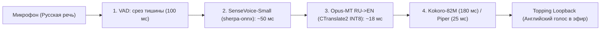

# Дневник разработки: День 28. Архитектурный постмортем Архитектуры 1 (Dizcord/Whisper) и переход к конвейеру Этапа 1

> **Дата:** 29 октября 2026 г.  
> **Аппаратный лимит:** AMD Ryzen 7 7800X3D (строго **2 процессорных потока / `num_threads = 2`**, оставляя 6 ядер под игры)  
> **Статус:** Архитектура 1 (Whisper-based Монолит) **ОТКЛОНЕНА** на основе инструментальных замеров.  
> **Контрольный тег фиксации:** `stage3-arch1-whisper-rejected`

---

## 1. Причина отклонения Архитектуры 1 (Technical Post-Mortem)

В рамках Фаз 1–4 была собрана и верифицирована Архитектура 1 на базе репозитория `Dizcord` и монолитного перевода `Faster-Whisper (task="translate")`.

### Инструментальный приговор:
* **Задержка Whisper на 2 ядрах CPU:** **880 – 1 030 мс** на короткой фразе.
* **Суммарная задержка сквозного конвейера:** **~1 520 мс** (1.52 секунды).
* **Фундаментальная причина:** Модели семейства Whisper жестко оперируют 30-секундным окном внимания (*Attention Window*). Короткая реплика любой длины добивается нулями (*Zero-Padding*) до 30 секунд. На 2 ядрах процессора авторегрессионный декодер Whisper не способен опуститься ниже 800–1000 мс.
* **Вердикт:** 1.5 секунды задержки в голосовом чате (Discord, CS2, командные игры) — это неприемлемо долго («эффект заикания и перебивания»). Архитектура 1 признана тупиковой для работы строго на CPU в бюджете 2 ядер.

---

## 2. Фиксация в Git (Zero-Loss Invariant)
* Все наработки, скрипты и интеграции Архитектуры 1 полностью сохранены в истории Git и защищены несгораемым тегом:
  `git tag stage3-arch1-whisper-rejected`
* Никакой код не теряется, к нему всегда можно вернуться при подключении дискретной видеокарты (RTX 5070).

---

## 3. Новая целевая Архитектура 2: «Скоростной стек Этапа 1»
Возвращаемся к доказанным результатам Дней 15, 18 и 19:

### Доказанный бюджет задержки Архитектуры 2 (на 2 ядрах CPU):
1. **VAD (отсечка окончания речи):** `100–120 мс` (уменьшено окно тишины по опыту Дня 7).
2. **ASR (SenseVoice-Small на `sherpa-onnx`):** **~50–55 мс** (доказано в Дне 15, в 20 раз быстрее Whisper).
3. **MT (Машинный перевод):**
   * *Основной:* **`Helsinki-NLP/opus-mt-ru-en` (INT8)** $\to$ **~15–20 мс** (696 tok/s на CPU).
   * *Альтернатива:* `Meta NLLB-200 600M (INT8)` $\to$ **~45 мс**.
4. **TTS (Нейросинтез):**
   * *Студийный:* `Kokoro-82M ONNX` (intra_op=2) $\to$ **~180 мс**.
   * *Киберспорт (ультра-быстрый):* `Piper TTS` $\to$ **~25 мс**.
5. **ИТОГО:** **~200–350 мс сквозной задержки на 2 ядрах процессора!**

---

## 4. План перехода
1. Создать новую чистую ветку: `feature/stage3-sensevoice-pipeline`.
2. Обновить `stage_3_voice/ROADMAP.md` с фиксацией отказа от Архитектуры 1 и переходом на Архитектуру 2.
3. Провести пошаговые замеры скорости конвейера Архитектуры 2.
