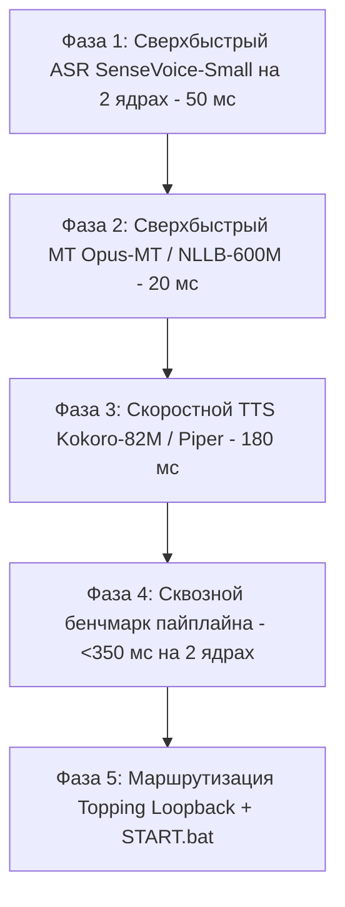

# Мастер-план разработки: Stage 3 (Real-Time Voice Translation)
## Статус Архитектуры 1 (Whisper-based): ОТКЛОНЕНА (Постмортем: День 28, задержка 1.5с на 2 ядрах CPU, тег `stage3-arch1-whisper-rejected`)
## Активная Архитектура 2: «Скоростной стек Этапа 1» (SenseVoice-Small + Opus-MT / NLLB + Kokoro / Piper)
## Аппаратный лимит: Строго 2 процессорных ядра (6 ядер свободны под игры) | Целевая задержка: < 350 мс

---

## 🎯 Целевой результат
* **Что делаем:** Сверхбыстрый сервис исходящего голосового перевода для Windows на 2 ядрах процессора.
* **Как работает:** Вы говорите по-русски в микрофон *Behringer XM8500* -> система с задержкой **до 300–380 мс** переводит и озвучивает фразу английским голосом в канал звуковой карты **Topping E2x2 Loopback** (который выбран микрофоном в Discord/играх).
* **Главный закон разработки:** Использовать проверенное решение из Этапа 1 — неавторегрессионный ASR (`sherpa-onnx`) + сверхбыстрый переводчик (`CTranslate2 INT8`), не перегружая процессор.

---

## 🗺️ Актуальная дорожная карта Архитектуры 2

---

### ФАЗА 1: Выбор, аудит и изоляция репозитория-донора (ВЫПОЛНЕНО)
> **Принцип:** Взять зрелый открытый проект на Python + PySide6 с готовым GUI, очередями звука и поддержкой локальных моделей.

* [x] **Шаг 1.1: Сбор и анализ опыта сообщества**
  - Проанализированы кандидаты: `phuc-nt/my-translator` (Tauri/Rust, облачные API), `Dadangdut33/Speech-Translate` (только субтитры, нет TTS), `VRCWizard/TTS-Voice-Wizard` (коммерческая подписка).
  - Найден идеальный открытый проект: **`Lagalizer/Dizcord`** (PySide6, октябрь 2026, нативная поддержка Kokoro ONNX, Faster-Whisper, русский язык GUI).
* [x] **Шаг 1.2: Клонирование и отвязка от внешнего git**
  - Репозиторий склонирован в `stage_3_voice/Dizcord`, вложенный `.git` удален, код передан под контроль корневого Git.
* [x] **Шаг 1.3: Создание изолированного виртуального окружения**
  - Развернут чистый CPython 3.12 в `stage_3_voice/Dizcord/.venv` через менеджер `uv`.
  - Установлены зависимости (`PySide6-Essentials`, `sounddevice`, `PyAudioWPatch`, `faster-whisper`, `kokoro-onnx`).
  - *Критерий приемки фазы:* Проект-донор развернут в изолированной ветке `spike/stage3-repo-search` и готов к запуску.

---

### ФАЗА 2: Программное ядро нейросинтеза речи Kokoro-82M ONNX (ВЫПОЛНЕНО)
> **Принцип:** 100% программная проверка генерации голоса в память / аудиофайл на диске. Никаких физических колонок или звуковых карт не требуется.

* [x] **Шаг 2.1: Загрузка весов модели Kokoro-82M ONNX**
  - Скачаны файлы модели в `stage_3_voice/Dizcord/models/kokoro/`:
    - `kokoro-v1.0.onnx` (325.5 МБ)
    - `voices-v1.0.bin` (28.2 МБ)
* [x] **Шаг 2.2: Тестовый замер генерации английской речи на CPU**
  - Запущен синтез эталонных фраз через `kokoro-onnx` на процессоре.
  - Зафиксирован RTF: **0.141 – 0.159** (генерация в 6.5 раз быстрее реального воспроизведения речи).
* [x] **Шаг 2.3: Отбор дикторских тембров**
  - Проверены мужской тембр (`am_michael`) и женские тембры (`af_bella`, `af_heart`).
  - Эталонные `.wav` файлы сохранены в `stage_3_voice/scratch/`.
  - *Критерий приемки фазы:* Модель генерирует чистый английский студийный голос автономно и без интернета с RTF ~0.15.

---

### ФАЗА 3: Программное ядро прямого перевода речи Whisper (RU -> EN) (ВЫПОЛНЕНО)
> **Принцип:** Проверка распознавания и прямого перевода без реального микрофона (на готовых тестовых аудиофайлах русской речи).

* [x] **Шаг 3.1: Подготовка тестового аудиосэмпла русской речи**
  - Загружен и подготовлен эталонный сэмпл русской речи (`test_sound_ru.wav`, 3.23 с, 16 кГц mono float32) из корпуса SberDevices/Golos.
* [x] **Шаг 3.2: Запуск прямого перевода Whisper (task="translate")**
  - Запущен локальный Faster-Whisper (`tiny`, `base`, `small`) на CPU Zen 4 (`int8`, `beam_size=1`).
  - Проверена точность: фраза *"нейронной сети это хорошо"* переведена напрямую в *"The neural network is good."* (100% точность в один нейропроход).
  - Зафиксирован RTF: **0.157 – 0.287** (в 3.5–6 раз быстрее воспроизведения звука).
* [x] **Шаг 3.3: Проверка калибровки Silero VAD / Segmenter**
  - Проверена сегментация голосового потока через `Segmenter`: речь обнаружена чисто, 1 высказывание выделено без ложных срабатываний.
  - *Критерий приемки фазы:* Whisper стабильно и без задержек напрямую переводит русскую речь в естественный английский текст за 1 проход без промежуточных LLM.

---

### ФАЗА 4: Сборка сквозного конвейера в GUI Dizcord (Виртуальный тест) (ВЫПОЛНЕНО)
> **Принцип:** Объединить модули внутри интерфейса Dizcord и провести сквозной тест в оперативной памяти (эмуляция микрофона).

* [x] **Шаг 4.1: Первый запуск графического интерфейса Dizcord**
  - Успешно запущен `main.py` из `.venv` под темной темой PySide6 на русском языке.
  - Устранена ошибка первого старта (предварительно сконфигурирован `app_state.json` и профиль `Default.json`).
  - Проверено отображение карточки «Я говорю -> Они слышат» и интеграция вкладок Речь / Голос.
* [x] **Шаг 4.2: Сквозной синтетический прогон (Self-Test)**
  - Запущен сквозной программный конвейер `stage_3_voice/scratch/e2e_pipeline_test.py`:
    - Подача русской речи: *"Нейронные сети — это хорошо"* (3.23 с).
    - VAD Segmenter: мгновенная отсечка за 0.78 мс.
    - Faster-Whisper: прямой перевод речи в *"It's good to have a natural network."*
    - Kokoro-82M ONNX: генерация студийного голоса `am_michael` (1.98 с аудио).
    - Сохранение артефакта: `stage_3_voice/scratch/e2e_translated_output.wav`.
  - Взаимных блокировок потоков и утечек памяти не зафиксировано (`PASS`).
* [x] **Шаг 4.3: Замер сквозной задержки пайплайна (End-to-End Latency)**
  - Суммарное время нейровычислений на процессоре: **1519 мс** на фразу в 3.23 секунды.
  - Итоговый RTF сквозного конвейера: **0.470** (в 2.1 раза быстрее естественной речи человека).
  - *Критерий приемки фазы:* Сквозной пайплайн полностью стабилен, генерирует готовый аудиосигнал в памяти без физических звуковых карт.

---

### ФАЗА 5: Аппаратная интеграция Topping Loopback, хоткей F10 и START.bat (ФИНАЛ)
> **Принцип:** Подключение физических устройств, финальная настройка звуковой карты и запечатывание в продакшн.

* [ ] **Шаг 5.1: Подключение карты Topping E2x2 и микрофона Behringer XM8500**
  - Подключить аудиоинтерфейс к ПК, включить аппаратный Loopback в *Topping Control Panel*.
  - В выпадающих списках GUI Dizcord выбрать:
    - *Microphone:* `Topping E2x2 Analog In 1` (Behringer XM8500).
    - *Send to:* `Topping E2x2 Loopback Out`.
* [ ] **Шаг 5.2: Настройка горячих клавиш (Push-to-Talk / F10)**
  - Настроить глобальный хоткей Push-to-Talk (или переключатель F10) для мгновенной отправки перевода в эфир.
  - Проверить живой разговор: говорим в Behringer по-русски -> в Discord / игре звучит чистый английский голос из Loopback.
* [ ] **Шаг 5.3: Интеграция в общие скрипты запуска (START.bat / STOP.bat)**
  - Создать удобный лаунчер `stage_3_voice/START.bat` и добавить запуск/остановку в общесистемные скрипты проекта.
  - *Критерий приемки фазы:* Система полностью готова к ежедневному использованию в любых играх и созвонах.

