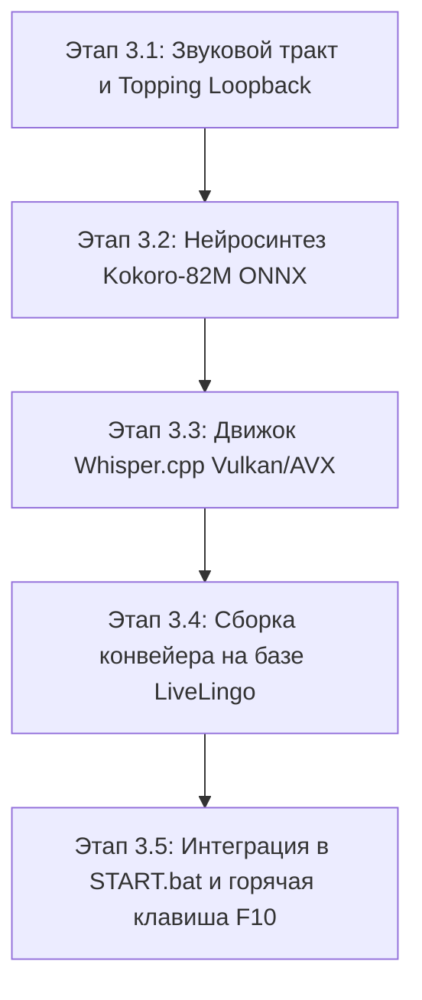

# Дорожная карта разработки: Stage 3 (Real-Time Voice Translation)
## Архитектура 1: «Vulkan / C++ Монолит» (Whisper.cpp + Kokoro-82M ONNX)

---

## 🎯 Цель этапа
Создать изолированный, сверхбыстрый и надежный голосовой мост для Windows:
* **Вход:** Микрофон *Behringer XM8500* (через звуковую карту *Topping Professional E2x2 OTG: IN 1*).
* **Ядро:** 
  1. *Silero VAD* (отсечение тишины, порог паузы 250 мс).
  2. *whisper.cpp* с ускорением через **Vulkan** (на встроенном iGPU Radeon) или **AVX-512** (на ядрах AMD Ryzen Zen 4) в режиме прямого перевода RU → EN за один проход (`task="translate"`, `beam_size=1`).
  3. *Kokoro-82M ONNX* (синтез естественного английского дикторского голоса за ~100 мс на CPU).
* **Выход:** Аппаратный канал **Topping E2x2 Loopback** (без использования виртуальных кабелей вроде VB-Cable). Discord, Teams и игры слушают этот канал как обычный микрофон.
* **Бюджет времени:** Общая сквозная задержка **< 500 мс** на рабочем ПК (CPU/iGPU) и **< 380 мс** при подключении внешней карты RTX 5070.

---

## 🗺️ Поэтапный план реализации (Milestones)

---

### Этап 3.1: Звуковой тракт и привязка Topping Loopback
* [ ] **3.1.1.** Создать утилиту сканирования аудиоустройств `stage_3_voice/tools/probe_audio_devices.py`:
  - Обнаружение физического входа микрофона: `Topping E2x2 OTG Analog 1/2 (IN 1)`.
  - Обнаружение аппаратного выхода: `Topping E2x2 OTG Loopback Out`.
* [ ] **3.1.2.** Провести инструментальный тест проброса звука:
  - Генерация тестового синусоидального тона 440 Гц или короткого PCM-буфера.
  - Воспроизведение в Loopback и проверка отсутствия щелчков и джиттера при буферах 128–256 сэмплов.

---

### Этап 3.2: Нейросинтез Kokoro-82M ONNX (Студийный английский голос)
* [ ] **3.2.1.** Интеграция легковесного инференса `kokoro-onnx` в окружение Python:
  - Скачивание квантованной модели `kokoro-v1.0.onnx` (~80–150 МБ) и словаря голосов `voices.json`.
  - Отбор 3 лучших английских голосов: `af_sky` (американский женский), `af_bella` (естественный разговорный), `am_adam` (мужской дикторский).
* [ ] **3.2.2.** Бенчмарк инференса на процессоре Ryzen Zen 4:
  - Измерение Real-Time Factor (RTF) и времени генерации фразы из 10 слов.
  - Критерий прохождения: задержка синтеза **< 120 мс** на CPU.

---

### Этап 3.3: Движок прямого перевода Whisper.cpp (Vulkan / AVX-512)
* [ ] **3.3.1.** Развертывание бинарника `whisper.cpp` с поддержкой Vulkan:
  - Сборка / загрузка готового скомпилированного движка под Windows x64 с поддержкой бэкенда `ggml-vulkan.dll` и `AVX-512`.
  - Подключение модели `ggml-small-q5_0.bin` (или `base-q8_0.bin`).
* [ ] **3.3.2.** Тюнинг параметров ультранизкой задержки:
  - Режим `task="translate"`, целевой язык `language="en"`.
  - Жадный поиск `beam_size=1` (Greedy Decoding) без перебора альтернатив.
  - Ограничение окна токенов `max_tokens=64`.
* [ ] **3.3.3.** Замер скорости инференса:
  - Критерий прохождения: распознавание и перевод 2-секундного голосового отрезка за **< 140 мс** на iGPU Radeon (Vulkan) или CPU.

---

### Этап 3.4: Сборка конвейера на открытой базе (LiveLingo)
* [ ] **3.4.1.** Адаптация многопоточного каркаса `LiveLingo`:
  - `capture.py`: Захват звука с микрофона Topping IN 1.
  - `vad.py`: Быстрый шлюз *Silero VAD* (окно 30 мс, порог тишины 250 мс для фиксации окончания фразы).
  - `pipeline.py`: Асинхронные очереди без блокировки потоков (`chunk_queue` -> `stt_queue` -> `tts_queue` -> `loopback_queue`).
* [ ] **3.4.2.** Изоляция от Этапа 1:
  - Полная независимость от `LiveTranslate` и модели `HY-MT` (нулевое влияние на субтитры игры).

---

### Этап 3.5: Эргономика, горячие клавиши и экосистема
* [ ] **3.5.1.** Мастер-переключатель голосового перевода:
  - Назначение горячей клавиши (например, `F10` или клавиша на мыши) для мгновенного включения/выключения перевода микрофона.
  - Компактный индикатор в трее Windows (зеленый = перевод активен, серый = отключен).
* [ ] **3.5.2.** Интеграция в общие скрипты запуска:
  - Подключение сервиса в [`START.bat`](file:///c:/Users/SONATO/Dev/active/all_translete_online/START.bat).
  - Корректное завершение всех фоновых воркеров в [`STOP.bat`](file:///c:/Users/SONATO/Dev/active/all_translete_online/STOP.bat).
* [ ] **3.5.3.** Сквозной тест задержки (End-to-End Smoke Gate):
  - Проверка общего секундомера: от конца русской фразы до начала звучания английского голоса в Topping Loopback — **менее 500 мс**.
