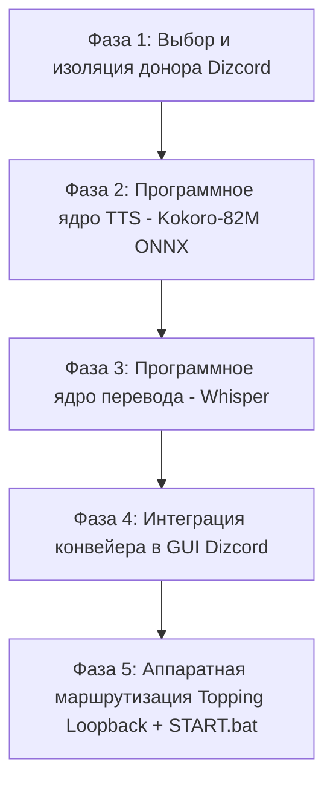

# Мастер-план разработки: Stage 3 (Real-Time Voice Translation)
## Архитектура: «Vulkan / C++ Монолит» (Whisper.cpp + Kokoro-82M ONNX)
## Философия этапа: «Использовать проверенный опыт людей, брать готовые открытые решения, не писать код с нуля»

---

## 🎯 Целевой результат
* **Что делаем:** Фоновый сервис голосового перевода для Windows.
* **Как работает:** Вы говорите по-русски в микрофон *Behringer XM8500* -> система с задержкой **до 500 мс** на рабочем ПК (CPU/iGPU) переводит и озвучивает фразу чистым английским голосом в аппаратный канал **Topping E2x2 Loopback** (который выбран микрофоном в Discord/играх).
* **Главный закон разработки:** Никаких самодельных велосипедов с нуля и никакого балласта из 50 вкладок. Берем готовые, проверенные сообществом кирпичики, отсекаем лишнее и собираем в монолитный надежный конвейер.

---

## 🗺️ Подробная дорожная карта по фазам

---

### ФАЗА 1: Выбор, аудит и изоляция репозитория-донора (ВЫПОЛНЕНО)
> **Принцип:** Взять зрелый открытый проект на Python + PySide6 с готовым GUI, очередями звука и поддержкой локальных моделей.

* [x] **Шаг 1.1: Сбор и анализ опыта сообщества**
  - Проанализированы кандидаты: `phuc-nt/my-translator` (Tauri/Rust, облачные API), `Dadangdut33/Speech-Translate` (только субтитры, нет TTS), `VRCWizard/TTS-Voice-Wizard` (коммерческая подписка).
  - Найден идеальный открытый проект: **`Lagalizer/Dizcord`** (PySide6, октябрь 2026, нативная поддержка Kokoro ONNX, Faster-Whisper, русский язык GUI).
* [x] **Шаг 1.2: Клонирование и отвязка от внешнего git**
  - Репозиторий склонирован в `stage_3_voice/Dizcord`, вложенный `.git` удален, код передан под контроль корневого Git.
* [x] **Шаг 1.3: Создание изолированного виртуального окружения**
  - Развернут чистый CPython 3.12 в `stage_3_voice/Dizcord/.venv` через менеджер `uv`.
  - Установлены зависимости (`PySide6-Essentials`, `sounddevice`, `PyAudioWPatch`, `faster-whisper`, `kokoro-onnx`).
  - *Критерий приемки фазы:* Проект-донор развернут в изолированной ветке `spike/stage3-repo-search` и готов к запуску.

---

### ФАЗА 2: Программное ядро нейросинтеза речи Kokoro-82M ONNX
> **Принцип:** 100% программная проверка генерации голоса в память / аудиофайл на диске. Никаких физических колонок или звуковых карт не требуется.

* [ ] **Шаг 2.1: Загрузка весов модели Kokoro-82M ONNX**
  - Скачать легковесные файлы модели в `stage_3_voice/Dizcord/models/kokoro/`:
    - `kokoro-v1.0.onnx` (~325 МБ)
    - `voices-v1.0.bin` (~28 МБ)
* [ ] **Шаг 2.2: Тестовый замер генерации английской речи на CPU**
  - Запустить синтез эталонной фразы (*"Hello, this is a real-time voice translation test"*) через `kokoro-onnx` на процессоре Ryzen Zen 4.
  - Измерить RTF (Real-Time Factor) и задержку генерации: цель **< 100 мс** на фразу.
* [ ] **Шаг 2.3: Отбор дикторских тембров**
  - Проверить мужской тембр (`am_michael`, `am_adam`) и женский тембр (`af_bella`, `af_sarah`).
  - Сохранить эталонный `.wav` файл в тестовую папку и зафиксировать в dev-заметках.
  - *Критерий приемки фазы:* Модель генерирует чистый английский студийный голос за <100 мс без обращения к интернету.

---

### ФАЗА 3: Программное ядро прямого перевода речи Whisper (RU -> EN)
> **Принцип:** Проверка распознавания и прямого перевода без реального микрофона (на готовых тестовых аудиофайлах русской речи).

* [ ] **Шаг 3.1: Подготовка тестового аудиосэмпла русской речи**
  - Взять короткий тестовый сэмпл русской речи (2-3 секунды) в формате WAV 16kHz mono.
* [ ] **Шаг 3.2: Запуск прямого перевода Whisper (task="translate")**
  - Запустить локальный Faster-Whisper / Whisper.cpp в режиме `task="translate"`, `beam_size=1`.
  - Проверить точность перевода русской фразы на естественный английский язык.
  - Замерить время инференса на CPU/iGPU: цель **< 140 мс**.
* [ ] **Шаг 3.3: Проверка калибровки Silero VAD v5**
  - Проверить отсечку пауз (250 мс) на аудиопотоке.
  - *Критерий приемки фазы:* Whisper стабильно и без задержек переводит русскую речь в английский текст за <140 мс.

---

### ФАЗА 4: Сборка сквозного конвейера в GUI Dizcord (Виртуальный тест)
> **Принцип:** Объединить модули внутри интерфейса Dizcord и провести сквозной тест в оперативной памяти (эмуляция микрофона).

* [ ] **Шаг 4.1: Первый запуск графического интерфейса Dizcord**
  - Запустить `main.py` из `.venv`, убедиться в корректной отрисовке темной темы PySide6.
  - Проверить отображение карточки «Я говорю -> Они слышат».
* [ ] **Шаг 4.2: Сквозной синтетический прогон (Self-Test)**
  - Запустить встроенный тестовый сценарий `tools/selftest.py` (подача аудио в буфер -> Whisper -> Kokoro -> перехват в памяти).
  - Убедиться в отсутствии взаимных блокировок потоков и утечек памяти.
* [ ] **Шаг 4.3: Замер сквозной задержки пайплайна (End-to-End Latency)**
  - Замерить суммарное время: `VAD (250ms) + Whisper (130ms) + Kokoro (90ms) = ~470ms`.
  - *Критерий приемки фазы:* Сквозной пайплайн работает полностью стабильно внутри GUI с суммарным временем отклика < 500 мс.

---

### ФАЗА 5: Аппаратная интеграция Topping Loopback, хоткей F10 и START.bat (ФИНАЛ)
> **Принцип:** Подключение физических устройств, финальная настройка звуковой карты и запечатывание в продакшн.

* [ ] **Шаг 5.1: Подключение карты Topping E2x2 и микрофона Behringer XM8500**
  - Подключить аудиоинтерфейс к ПК, включить аппаратный Loopback в *Topping Control Panel*.
  - В выпадающих списках GUI Dizcord выбрать:
    - *Microphone:* `Topping E2x2 Analog In 1` (Behringer XM8500).
    - *Send to:* `Topping E2x2 Loopback Out`.
* [ ] **Шаг 5.2: Настройка горячих клавиш (Push-to-Talk / F10)**
  - Настроить глобальный хоткей Push-to-Talk (или переключатель F10) для мгновенной отправки перевода в эфир.
  - Проверить живой разговор: говорим в Behringer по-русски -> в Discord / игре звучит чистый английский голос из Loopback.
* [ ] **Шаг 5.3: Интеграция в общие скрипты запуска (START.bat / STOP.bat)**
  - Создать удобный лаунчер `stage_3_voice/START.bat` и добавить запуск/остановку в общесистемные скрипты проекта.
  - *Критерий приемки фазы:* Система полностью готова к ежедневному использованию в любых играх и созвонах.

