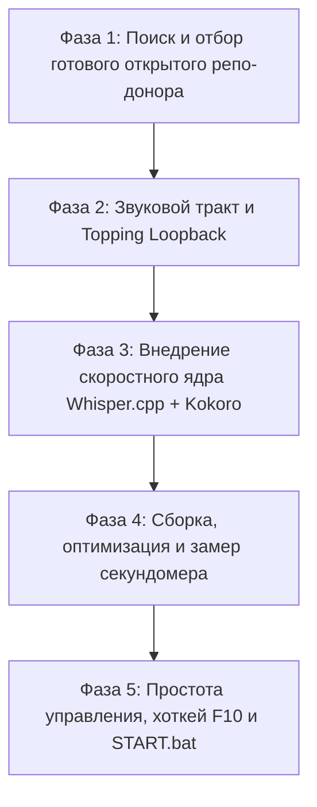

# Мастер-план разработки: Stage 3 (Real-Time Voice Translation)
## Архитектура: «Vulkan / C++ Монолит» (Whisper.cpp + Kokoro-82M ONNX)
## Философия этапа: «Использовать проверенный опыт людей, брать готовые открытые решения, не писать код с нуля»

---

## 🎯 Целевой результат
* **Что делаем:** Фоновый сервис голосового перевода для Windows.
* **Как работает:** Вы говорите по-русски в микрофон *Behringer XM8500* -> система с задержкой **до 500 мс** на рабочем ПК (CPU/iGPU) переводит и озвучивает фразу чистым английским голосом в аппаратный канал **Topping E2x2 Loopback** (который выбран микрофоном в Discord/играх).
* **Главный закон разработки:** Никаких самодельных велосипедов с нуля и никакого балласта из 50 вкладок. Берем готовые, проверенные сообществом кирпичики, отсекаем лишнее и собираем в монолитный надежный конвейер.

---

## 🗺️ Подробная дорожная карта по фазам

---

### ФАЗА 1: Поиск, сравнительный аудит и выбор легковесного Open-Source репозитория-донора
> **Принцип:** Найти готовое открытое приложение под Windows, в котором УЖЕ решена задача захвата микрофона и воспроизведения звука, с максимально простым управлением (1 кнопка или системный трей).

* [ ] **Шаг 1.1: Сбор и анализ опыта сообщества (GitHub / Reddit / Discord)**
  - *Что делаем:* Изучить, как реальные пользователи решают задачу передачи перевода в виртуальный/аппаратный микрофон для звонков и игр (ветки r/LocalLLaMA, репозитории для Discord и стриминга).
  - *Цель поиска:* Найти репозиторий с минимальным кодом, где есть чистая обвязка аудиопотоков и простой интерфейс (хоть 1 кнопка или значок в трее).
  - *Кандидаты для изучения:*
    1. `LiveLingo` — ультрамодульный Python-пайплайн с готовым захватом микрофона и очередями воспроизведения.
    2. Готовые легковесные трей-утилиты (на PyQt / PySide / C# / Rust Tauri), которые сидят в трее Windows и управляются горячей клавишей.
    3. Другие открытые аналоги, найденные в процессе аудита.
* [ ] **Шаг 1.2: Сравнительный аудит шорт-листа по критериям «Анти-балласт»**
  - Оценить сложность кода: проект не должен содержать гигабайты ненужных зависимостей и запутанных меню.
  - Оценить модульность: насколько легко вырезать чужие медленные облачные функции (Google/Groq/Edge-TTS) и подключить наш локальный C++/ONNX движок.
* [ ] **Шаг 1.3: Утверждение репозитория-победителя и клонирование**
  - Обсудить результаты с пользователем, выбрать лучший проект.
  - Клонировать репозиторий в папку `stage_3_voice/core` и зафиксировать в Git.
  - *Критерий приемки фазы:* Проект-донор выбран, одобрен и находится в нашей рабочей ветке.

---

### ФАЗА 2: Подготовка и инструментальная проверка звукового тракта Topping Loopback
> **Принцип:** Никаких сторонних виртуальных кабелей (VB-Cable). Использовать родные аппаратные возможности звуковой карты Topping Professional E2x2 OTG.

* [ ] **Шаг 2.1: Сканирование физических и логических каналов Topping E2x2**
  - *Что делаем:* Написать/запустить проверенную тестовую утилиту на `sounddevice` / `pyaudio` для поиска точных системных индексов и имен устройств в Windows.
  - *Цель:* Зафиксировать имена устройств:
    - Физический микрофонный вход: `Topping E2x2 OTG Analog 1/2 (IN 1)`.
    - Аппаратный канал петли: `Topping E2x2 OTG Loopback Out` (устройство воспроизведения).
    - Канал захвата для Discord: `Topping E2x2 OTG Loopback In` (устройство записи).
* [ ] **Шаг 2.2: Проверка аппаратной маршрутизации звуковой карты**
  - *Что делаем:* Изучить опыт настройки панели управления *Topping Control Panel* (маршрутизация Loopback).
  - *Тест:* Подать короткий чистый PCM-звук (тестовый сигнал) из скрипта в `Topping Loopback Out` и убедиться, что программа записи (или Discord) чисто принимает этот звук без щелчков, задержек и искажений.
* [ ] **Шаг 2.3: Подбор минимального размера аудиобуфера**
  - Настройка работы с буферами 128–256 сэмплов (задержка звукового драйвера ~2–4 мс).
  - *Критерий приемки фазы:* Звук из кода воспроизводится в канал Topping Loopback без единого виртуального кабеля.

---

### ФАЗА 3: Внедрение скоростного локального ядра (Whisper.cpp + Kokoro-82M)
> **Принцип:** Использовать готовые, прекомпилированные и оптимизированные сообществом бинарники и модели. Не компилировать всё с нуля.

* [ ] **Шаг 3.1: Подключение готового движка прямого перевода Whisper.cpp (Vulkan / AVX-512)**
  - *Что делаем:* Взять проверенный готовый релиз `whisper.cpp` с поддержкой бэкенда **Vulkan** (`ggml-vulkan.dll`) для встроенного видеоядра Radeon и инструкций **AVX-512** для процессора Ryzen Zen 4.
  - *Модель:* Загрузить компактную квантованную модель `ggml-small-q5_0.bin` (или `base-q8_0.bin`).
  - *Режим прямого перевода:* Настроить флаги:
    - `task="translate"` (прямой перевод RU -> EN за один математический проход).
    - `beam_size=1` (жадный поиск без холостых переборов вариантов).
    - `max_tokens=64` (ограничение длины фразы для микрофона).
  - *Замер скорости:* Убедиться, что расшифровка 2-секундного отрезка укладывается в **< 140 мс** на рабочем ПК.
* [ ] **Шаг 3.2: Подключение готового пакета нейросинтеза речи Kokoro-82M ONNX**
  - *Что делаем:* Использовать готовый открытый модуль `kokoro-onnx` от *thewh1teagle*.
  - *Модель:* Подключить легковесную квантованную модель `kokoro-v1.0.onnx` (~80 МБ) с C++ рантаймом `onnxruntime`.
  - *Отбор голосов:* Отобрать 2 лучших английских дикторских голоса (например, `af_sky` или `am_adam`) со студийным качеством (UTMOS 4.45).
  - *Замер скорости:* Убедиться, что синтез 2 секунд звука на процессоре Ryzen Zen 4 занимает **< 110–120 мс**.
* [ ] **Шаг 3.3: Интеграция готового детектора голоса Silero VAD v5**
  - Использовать готовый легковесный ONNX-модуль *Silero VAD* (задержка < 1 мс).
  - Откалибровать порог тишины (250 мс), чтобы фраза улетала в перевод сразу после естественной паузы в речи.
  - *Критерий приемки фазы:* Оба ядра (Whisper.cpp и Kokoro ONNX) работают локально на CPU/iGPU без интернета и без ошибок.

---

### ФАЗА 4: Сборка конвейера, разгон и инструментальный замер секундомера
> **Принцип:** Соединить захват звука, прямой перевод и синтез в асинхронный конвейер без взаимных блокировок и замерить реальное время сквозного прохождения.

* [ ] **Шаг 4.1: Сборка неблокирующего конвейера потоков**
  - Встроить подготовленные модули в выбранный на Фазе 1 репозиторий-донор:
    - *Поток 1 (Захват):* Микрофон Topping IN 1 -> Буфер Silero VAD.
    - *Поток 2 (Перевод):* Накопленный голосовой чанк -> Whisper.cpp (английский текст).
    - *Поток 3 (Озвучка):* Английский текст -> Kokoro-82M (PCM-аудио).
    - *Поток 4 (Вывод):* PCM-аудио -> Topping Loopback Out.
* [ ] **Шаг 4.2: Полная изоляция от субтитров Этапа 1**
  - Убедиться, что голосовой конвейер Stage 3 никак не пересекается с моделью субтитров `Tencent HY-MT 1.8B` и работает в изолированном адресном пространстве.
* [ ] **Шаг 4.3: Сквозной инструментальный замер задержки (Latency Gate)**
  - Запустить тест с секундомером от момента, когда вы замолчали, до момента, когда первый сэмпл английского звука зазвучал в Loopback.
  - *Критерий приемки:* 
    - На рабочем ПК (Ryzen CPU / iGPU Vulkan): общая сквозная задержка **< 500 мс**.
    - Дома с подключенной RTX 5070: общая задержка **< 380 мс**.

---

### ФАЗА 5: Простота управления, эргономика и запечатывание в START.bat
> **Принцип:** Никаких сложных меню во время работы. Управление одной кнопкой или горячей клавишей, надежный запуск и остановка.

* [ ] **Шаг 5.1: Управление одной кнопкой / хоткеем (F10)**
  - Реализовать мастер-переключатель: нажатие горячей клавиши `F10` (или клик по иконке в трее) мгновенно включает/выключает перевод микрофона.
  - Визуальный минимализм: маленькая цветовая точка (зеленый = перевод активен, серый = выключен).
* [ ] **Шаг 5.2: Интеграция в общую оркестрацию экосистемы**
  - Добавить запуск модуля голосового перевода в главный [`START.bat`](file:///c:/Users/SONATO/Dev/active/all_translete_online/START.bat).
  - Добавить корректное закрытие всех процессов в [`STOP.bat`](file:///c:/Users/SONATO/Dev/active/all_translete_online/STOP.bat).
* [ ] **Шаг 5.3: Комплексный стресс-тест двух этапов вместе**
  - Запустить одновременно Этап 1 (субтитры игры) и Этап 3 (перевод микрофона).
  - Проверить стабильность в течение 10 минут непрерывного разговора.
  - *Критерий приемки:* Ноль вылетов, чистый английский звук в Discord, субтитры на экране не тормозят.
